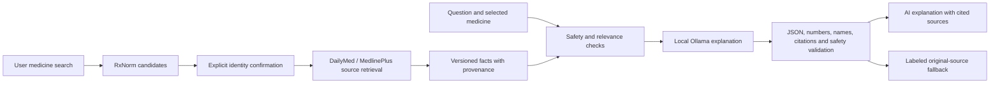

# AI assistant and voice features

The local API uses the existing Ollama `qwen3:8b` model. No cloud API key is required. Medicine information comes from retrieved official sources; the model explains that information and is never itself a medical source. Production configuration still defaults to AI disabled.

## Use the running app

1. Sign in to the mobile app connected to `http://10.0.2.2:18000/api/v1/` on Android Emulator.
2. On Home choose **Search medicine information**. For the verified example, enter `acetaminophen 500 mg oral tablet`, strength `500 mg`, and form `tablet`.
3. Review the exact identity before confirming it. The verified example is RxNorm `198440`; search position alone does not verify a medicine.
4. Open the assistant button on the medicine detail screen. Ask **Explain the warnings simply.** or **What does this medicine do?** The assistant uses the English/Urdu language and patient/student mode selected in the app's Settings.
5. The response shows its source references and limitations. **AI explanation** means a model response passed validation. **Original source** means a source extract was returned because generation was disabled, unavailable, or rejected. An English extract is explicitly identified when an Urdu translation could not be generated.

Stop cancels the current mobile request. Retry resubmits a failed question. Follow-up questions, source details, copying, reporting, and read-aloud controls are available on response cards. A cancelled model operation may finish on the server, but its late response cannot overwrite a newer mobile answer.

Local generation takes several seconds and varies with host load. The server allows 60 seconds; the mobile answer request allows 90 seconds. First-time medicine confirmation can also take time while official labels are retrieved. Subsequent source retrieval uses a versioned cache.

## Reproduce local setup

Install/start Ollama on the Docker host and make `qwen3:8b` available. On a new machine, `ollama pull qwen3:8b` downloads the model; `ollama serve` starts the service if it is not already running. The current workspace already has the model and running service. See the official [Ollama chat API](https://docs.ollama.com/api/chat) and [structured output documentation](https://docs.ollama.com/capabilities/structured-outputs).

For this workspace's existing Compose project and ports, run from the repository root:

```sh
MEDIEXPLAIN_DB_PORT=15432 MEDIEXPLAIN_API_PORT=18000 \
MEDIEXPLAIN_ADMIN_PORT=13001 MEDIEXPLAIN_MAIL_PORT=18025 \
MEDIEXPLAIN_SMTP_PORT=16025 \
docker compose -p mediexplain-local \
  -f docker-compose.yml -f docker-compose.ai.yml up -d --build
```

Always include both Compose files to keep local AI enabled on rebuild/restart. The override addresses Ollama through `host.docker.internal:11434`, as tested with Docker Desktop. On Linux, configure an equivalent reachable host address. `MEDIEXPLAIN_AI_MODEL` can select another installed Ollama model, but changing it requires repeating the source-fidelity checks.

At `http://localhost:13001/feature-flags`, an authorized administrator must enable `ai_assistant`. Enter its current revision and repeat the flag key in the confirmation field; changes are audited. This flag is already enabled in the running local workspace. Fresh databases retain the disabled default. Do not remove the existing database volume to enable AI.

The API also supports a separately configured OpenAI-compatible provider. Base URLs may include or omit `/v1`. External-provider credentials, consent, and clinical review remain deployment requirements; this pass exercised local Ollama.

## Data flow and failure behavior



RxNorm exact-name lookup is used when its standard search returns no concepts. Combination ingredients retain independent strengths, unsupported medication packs are excluded, and candidates are ranked before the service limits results. A provider implementation change refreshes even a previously fresh cache entry, avoiding persistent old empty results. Source summaries without medical content are not turned into facts. DailyMed retrieval uses its [official SPL API](https://dailymed.nlm.nih.gov/dailymed/webservices-help/v2/spls_api.cfm).

Questions requesting treatment changes, unrelated questions, absent context, and prompt injection receive explicit limited responses. Malformed model JSON, timeouts, invalid source IDs, unsupported numbers/units, and failed validation preserve an honest source fallback. Model health records actual latency and success/failure without recording raw questions or answers in operational metrics. Saved question/answer bodies remain encrypted in the application database.

Validation reduces specific errors; it cannot establish the medical accuracy of every paraphrase. Urdu uses a translation glossary and checks selected organ concepts against the source to reject the liver/stomach substitution found during testing. All clinical explanations, translations, and additional models still require independent professional review before patient-facing production use. Interaction checking remains unavailable without a validated interaction provider.

## Voice commands

Open **Profile → My Medications → Voice assistant**. Speech recognition and a typed command field share the same parser. Review the recognized command, then use its navigation button:

| Command type | Actual action |
| --- | --- |
| Search, including `search hypertension` | Opens terminology search with the query |
| Reminders or mark taken | Opens today's visual medication timeline for review |
| Read medicine | Opens My Medications |
| Open prescription | Opens prescription history |
| Explain warning | Opens medicine information search |
| Treatment/dose change | Refuses the change and offers no mutation action |

English and selected Urdu intents are supported. Voice commands never silently change a dose or mark one taken. Microphone/recognition and text-to-speech availability depend on the device. When unavailable, the app explains the problem and keeps typing available. Physical-device speech recognition and audio quality remain unverified.

## Repeat the live input/output check

```sh
cd services/api
.venv/bin/python -m tests.smoke_ai \
  --output ../../docs/smoke-evidence/2026-10-12/ai-live-smoke.json
```

This localhost-only check creates a disposable account, resolves the exact medicine, retrieves real source facts, and requires genuine model generation for English warnings, uses, student mode, and Urdu. It separately checks unrelated questions, missing context, English/Urdu dose changes, and prompt injection. It deletes the account afterward and keeps legitimate shared source cache entries. Inspect the recorded answers as well as the pass/fail result; a fallback does not count as successful AI generation.

Current results and device evidence are recorded in [the smoke report](SMOKE_TEST_REPORT.md).
