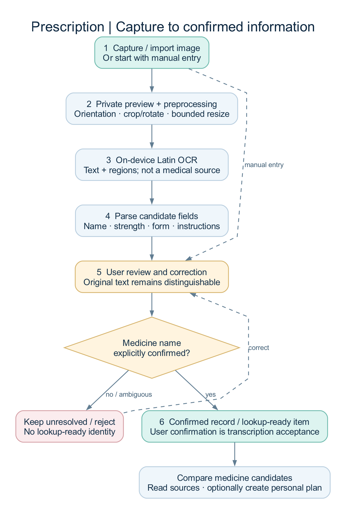
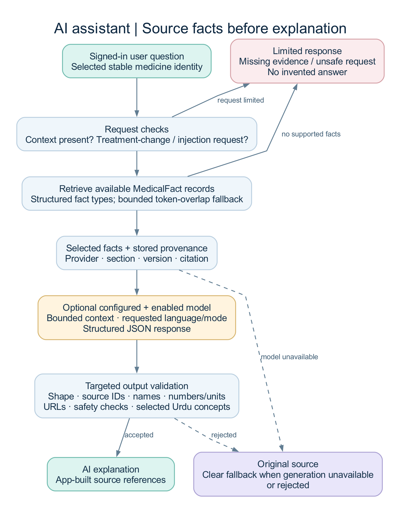
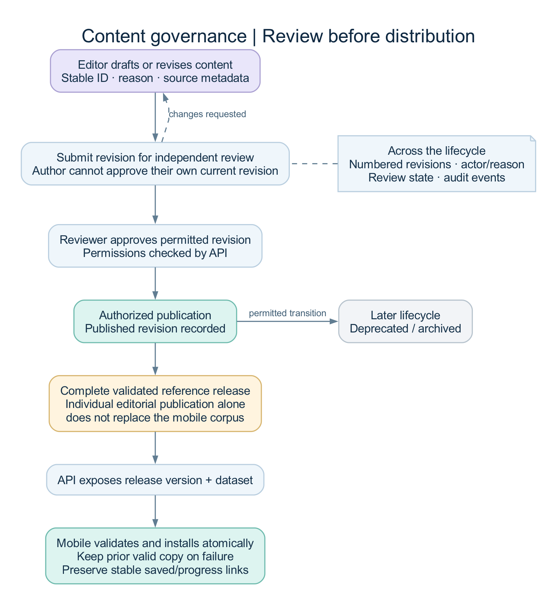
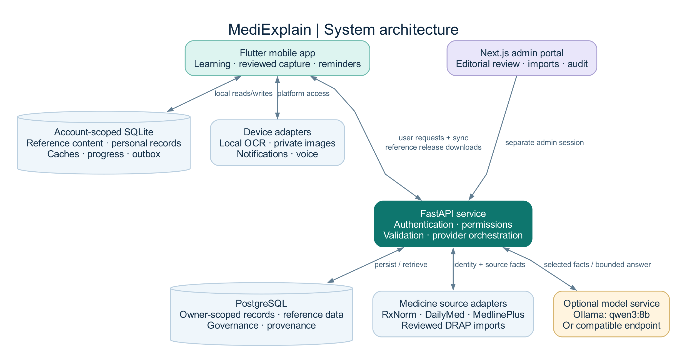
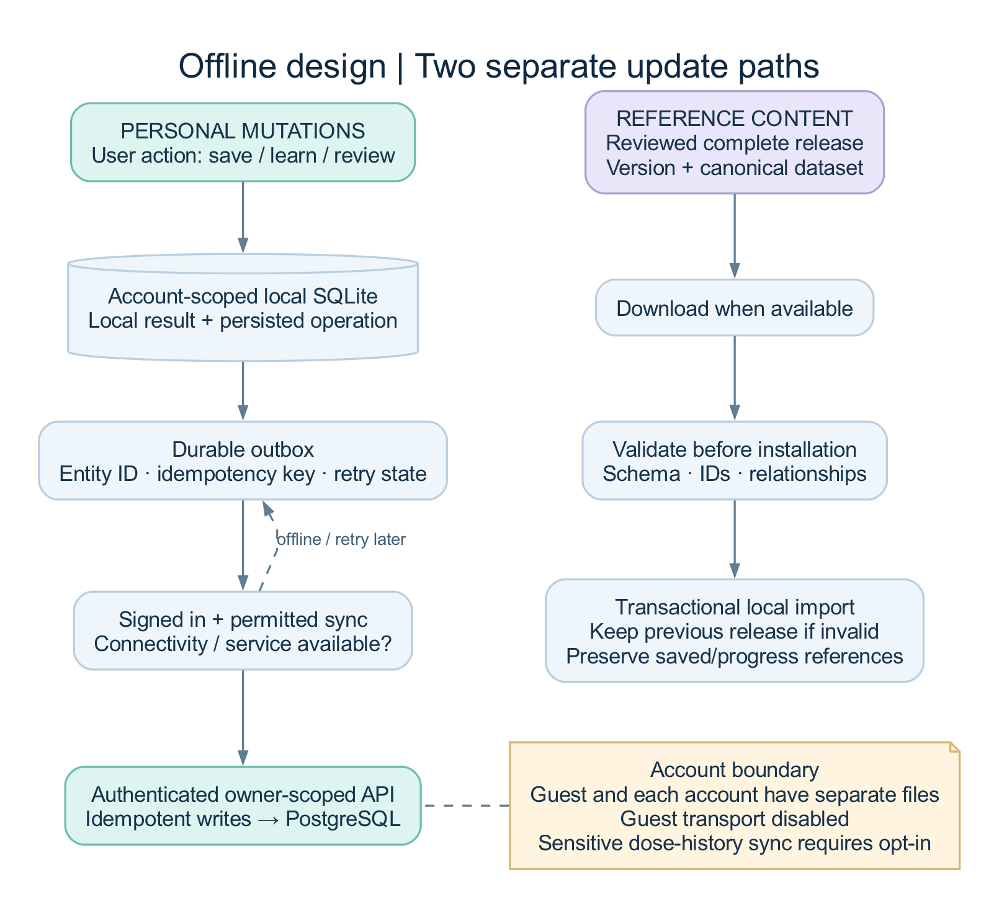
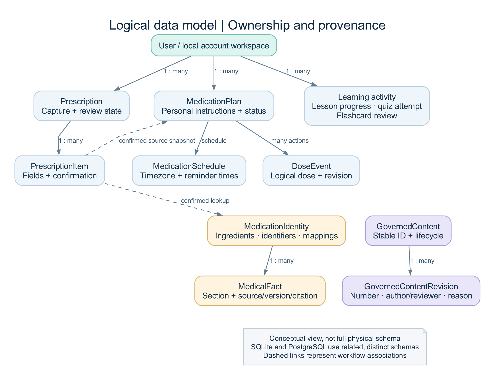

# MediExplain — FYP Project and Presentation Guide

**Suggested project title:** MediExplain: An Offline-First Medical-Literacy and Medication Support Platform with Source-Grounded AI

**Prepared from:** the current mobile, API, and administration code and recorded verification evidence.  
**Analysis date:** 12 October 2026.  
**Delivery scope:** a working local development build, with production requirements documented.  
**Purpose:** a reference for preparing slides, explaining the implementation, demonstrating the system, and answering teachers' questions.

The [editable Word copy](FYP_PRESENTATION_GUIDE.docx) contains the same material. Use this Markdown file as the source when updating the presentation. The system diagrams are also available as PNG and SVG files in [presentation-assets](presentation-assets/).

## Contents

1. Project identity, abstract, and short pitch
2. Problem statement and objectives
3. Users, roles, and use cases
4. Scope and current implementation status
5. Complete functionality catalogue
6. Detailed workflows: how the system works
7. Architecture and technology choices
8. Offline behavior and synchronization
9. Algorithms and decision rules
10. Data model and database relationships
11. Datasets, external sources, and provenance
12. Security, privacy, and safety boundaries
13. Nonfunctional requirements and practical limits
14. Testing and input/output evidence
15. Screens and screenshot evidence
16. Academic contribution and evaluation plan
17. Suggested 18-slide presentation with speaker notes
18. Live demonstration plan
19. Likely viva questions and suggested answers
20. Limitations, future work, and production requirements
21. Source-code map and representative API routes
22. Glossary and presentation checklist

## 1. Project identity, abstract, and short pitch

### 1.1 Core concept

MediExplain helps people **understand medical language, review captured prescription information, organize medication reminders, and read explanations tied to identifiable medical sources**. It combines a mobile application for users, an API for authenticated data and integrations, and an administration portal for content governance.

The central design rule is:

> Trusted source → structured information with provenance → optional AI explanation → validation → user.

The application keeps five different kinds of information separate: the original prescription, the user's corrections and confirmation, external medicine information, personal medication schedules and notes, and generated explanations. This separation makes it possible to explain where a statement came from and who confirmed it.

### 1.2 Abstract suitable for a report

MediExplain is an offline-first medical-literacy and personal medication-support platform developed with Flutter, FastAPI, PostgreSQL, and Next.js. The mobile application provides terminology search, word decomposition, abbreviations, lessons, flashcards, quizzes, prescription capture, medication reminders, and source-backed medicine explanations. Prescription images are processed locally using OCR, and extracted fields require explicit user review before entering downstream medication workflows. Medication identities are resolved through provider adapters, while retrieved facts preserve source, version, language, jurisdiction, and citation metadata. An optional local language model explains selected source information through a guarded retrieval workflow. The administration application supports role-controlled editorial review, reference releases, imports, reports, feature flags, and audit records. Local storage and an idempotent outbox support continued use during connectivity loss. Recorded verification includes automated API and Flutter tests, browser workflows, live API/model scenarios, and Android emulator demonstrations. The current deliverable is a local FYP implementation; clinical validation, broader datasets, physical-device verification, and production deployment remain separate requirements.

### 1.3 Thirty-second pitch

“MediExplain brings medical terminology learning, reviewed prescription capture, medication organization, and source-backed AI explanations into one mobile workflow. Basic learning and personal records work locally. The user confirms OCR output, official sources supply medicine facts, and the AI explains those facts with citations. A separate admin portal controls content review and publication.”

### 1.4 One-minute introduction

“Our project addresses a practical understanding problem: medical terms, abbreviations, and medicine information can be difficult to interpret, and people often manage learning material, prescription images, and reminders separately. We built MediExplain to connect these activities. A user can search an unfamiliar term, learn through lessons and quizzes, capture a prescription for manual review, create reminders from confirmed information, and ask a source-grounded assistant about a selected medicine. Flutter provides the mobile interface and local database; FastAPI handles authenticated services and provider integrations; Next.js provides the content-governance portal. The main engineering contribution is a traceable workflow that preserves user confirmation, source provenance, offline behavior, and access boundaries.”

### 1.5 What to call the project

| Appropriate description | Reason |
| --- | --- |
| Medical-literacy and medication-support platform | Covers the whole implemented system |
| Offline-first mobile application with governed reference content | Describes storage and content distribution accurately |
| Source-grounded educational AI assistant | Describes the model's limited role |
| Local FYP implementation with documented production requirements | Matches the agreed delivery scope |

Do not describe the current project as an autonomous doctor, a diagnostic engine, a clinically validated prescribing system, a complete Pakistani drug registry, or an already deployed hospital system. Those claims are not established by the implementation or test evidence.

## 2. Problem statement and objectives

### 2.1 Problem statement

The project addresses four connected user tasks: understanding medical vocabulary, organizing information from a prescription, remembering a personally configured medication schedule, and locating understandable medicine information with a visible source. A disconnected workflow makes users repeat searches and move between different records. Unreviewed OCR and uncited model responses introduce additional uncertainty.

This is the project's design motivation. The repository does not contain a population survey proving how common these problems are, or a clinical study showing improved health outcomes. Present those as future evaluation questions rather than measured findings.

### 2.2 Main objective

Develop a usable, locally demonstrable platform that combines medical education and personal medication organization while preserving confirmation, provenance, privacy, and recoverable failure behavior.

### 2.3 Specific objectives

1. Provide searchable medical terminology with simple and technical explanations.
2. Support English/Urdu interfaces, patient/student modes, and accessibility settings.
3. Provide lessons, quizzes, flashcards, spaced repetition, and persistent progress.
4. Extract prescription text locally and require correction/confirmation before further use.
5. Resolve selected medicine identities and display referenced source information.
6. Let users choose reminder schedules and record dose-log actions without generating treatment decisions.
7. Provide source-backed AI explanations with transparent fallback states.
8. Separate guest and account data and support authenticated synchronization.
9. Give administrators controlled editorial, import, reporting, and audit workflows.
10. Verify the implementation through automated checks and actual input/output demonstrations.

### 2.4 Expected value versus measured value

The intended value is easier access to understandable information and better organization of personal records. The measured value currently consists of functioning workflows and test results. Do not turn those test results into claims that the app reduces medical errors, improves adherence, or replaces professional advice.

## 3. Users, roles, and use cases

### 3.1 User groups

| Actor | Main activities | Boundary |
| --- | --- | --- |
| Guest | Search installed terminology, learn, keep local records and reminders | No authenticated server synchronization or medicine-assistant access |
| Registered user | Guest features plus account sessions, authenticated medicine information, and permitted sync | Access is scoped to their account |
| Patient-mode user | Read simpler explanations and organize confirmed information | Mode changes presentation depth, not medical facts |
| Student-mode user | Read more technical definitions, morphology, and sourced explanations | The same source and safety rules apply |
| Content editor | Create and revise editorial drafts, submit for review | Cannot approve their own current revision |
| Content reviewer | Review source-backed revisions and approve permitted changes | Independent review is enforced |
| Platform/super administrator | Manage permitted operational and publication controls | Backend permission checks still apply |
| Support user | Inspect permitted support/report views | Restricted access; does not automatically receive patient records or AI transcripts |

“Patient” and “student” are explanation modes, not proof of medical status or clinical qualifications. The backend administrative roles are `SUPER_ADMIN`, `PLATFORM_ADMIN`, `CONTENT_EDITOR`, `CONTENT_REVIEWER`, and `SUPPORT_READ_ONLY`.

### 3.2 Main use cases

- Understand an unfamiliar medical term or abbreviation.
- Decode the components of a medical word.
- Study a lesson, review flashcards, and complete a quiz.
- Capture/import a prescription image and correct extracted fields.
- Confirm the medicine name and distinguish similar medicine candidates.
- Read official medicine information and inspect its provenance.
- Ask a general question about a selected medicine's available source information.
- Create a personal reminder schedule and record taken/skipped/unrecorded states.
- Save reference material and resume learning later.
- Report questionable information for editorial review.
- Review, publish, and distribute a complete reference release through the admin portal.

## 4. Scope and current implementation status

### 4.1 Status vocabulary

**Implemented** means the relevant code and interface exist. **Runtime verified** means a specific recorded path was exercised against the actual local app/services. **Device/provider dependent** means availability depends on the operating system or an external integration. **Future work** means it must not be presented as complete.

### 4.2 Scope matrix

| Area | Current scope and status |
| --- | --- |
| Terminology and learning | Implemented, offline-capable, with automated and Android evidence |
| Prescription image import and printed Latin OCR | Implemented; image-import/OCR/review path exercised on Android |
| Camera and document capture | Implemented adapters/screens; representative physical-device checks remain |
| Medicine identity and referenced facts | Implemented; actual RxNorm/DailyMed retrieval verified for a recorded example |
| English/Urdu AI explanation | Implemented and tested with local Ollama; no clinical accuracy certification |
| Reminders and dose history | Implemented; Android alarm scheduling observed; scheduled-time delivery was not observed in the recorded pass |
| Voice commands | Implemented; typed navigation verified on Android; microphone recognition remains device-dependent |
| Admin governance and dashboard | Implemented; nine browser workflows recorded |
| Authentication and recovery | Implemented; SMTP reset and session revocation exercised locally |
| Offline account separation and sync | Implemented with regression and live API coverage |
| Drug interactions | Interface exists; no validated provider is configured |
| DRAP product coverage | Reviewed dataset import adapter exists; no claim of complete registry coverage |
| FHIR exchange | Conservative draft mapping exists; no hospital integration or profile-conformance certification |
| iOS and production deployment | Not verified/deployed in this delivery |

### 4.3 Out of scope for the current release

Diagnosis, personalized prescribing, dose changes, automated medicine substitution, emergency triage, automatic treatment decisions from OCR, doctor appointments, pharmacy sales, insurance/billing, and hospital/EHR integration are outside the delivered scope. These are not hidden capabilities of the AI assistant.

## 5. Complete functionality catalogue

The IDs below are presentation/reference labels, not claims of a separately signed requirements specification.

### 5.1 Foundation, account, and settings

| ID | Function | Behavior |
| --- | --- | --- |
| FR-01 | Onboarding and educational consent | Introduces the app and records completion/consent state |
| FR-02 | Guest access | Provides local features without forcing account creation |
| FR-03 | Registration and login | Creates a named user and obtains an authenticated session |
| FR-04 | Refresh, logout, and session management | Rotates refresh credentials; lists/revokes sessions; clears local session credentials on logout |
| FR-05 | Password recovery | Uses a single-use, expiring reset code delivered through configured SMTP; successful reset revokes earlier sessions |
| FR-06 | Profile and account deletion | Supports profile preferences and owner-scoped account removal |
| FR-07 | Language and explanation settings | English/Urdu, patient/student mode, and explanation depth |
| FR-08 | Accessibility and appearance | System/light/dark theme, text scale, larger controls, high readability, reduced motion, haptics, and TTS settings |
| FR-09 | Privacy and synchronization controls | Controls sync and sensitive medication-history sharing; analytics is disabled by default |
| FR-10 | Biometric lock abstraction | Delegates authentication to device facilities; actual platform behavior needs device verification |

### 5.2 Terminology and education

| ID | Function | Behavior |
| --- | --- | --- |
| FR-11 | Ranked terminology search | Exact names, synonyms, lay equivalents, abbreviations, partials, and bounded fuzzy matches |
| FR-12 | Search filters and history | Category/language/review-aware queries and device-local search history |
| FR-13 | Term detail | Simple/technical definitions, explicit related terms, sources, and save/report/read-aloud controls |
| FR-14 | Word decoder | Explains recognized prefixes, roots, and suffixes without inventing an authoritative definition |
| FR-15 | Abbreviation explorer | Displays expansions and preserves ambiguity instead of silently selecting one meaning |
| FR-16 | Morphology and category libraries | Browsable prefixes, roots, suffixes, and categorized reference content |
| FR-17 | Saved library | Retains bookmarked material using stable record IDs |
| FR-18 | Term of the day | Deterministic daily selection from the installed reference corpus |
| FR-19 | Lessons | Sourced sections with resume position, progress, completion, and review state |
| FR-20 | Flashcards | Reveal/review sessions, review-performance choices, and persisted schedules |
| FR-21 | Spaced repetition | Calculates the next review date from previous schedule and user-rated performance |
| FR-22 | Quizzes and mistake review | Configurable available questions, deterministic scoring, selected/correct answers, and explanations |
| FR-23 | Progress and streaks | Aggregates stored activity; opening a screen alone does not count as study activity |

### 5.3 Prescription capture and review

| ID | Function | Behavior |
| --- | --- | --- |
| FR-24 | Capture/import options | Camera, gallery/file, supported document capture, and manual entry routes |
| FR-25 | Private preview and preprocessing | Private image copy, orientation/crop/rotation support, bounded resize, and conservative contrast adjustment |
| FR-26 | Local OCR | ML Kit Latin recognizer extracts text blocks/lines/elements and bounding regions on device |
| FR-27 | Structured parsing | Suggests medication name, strength, form, dose, route, frequency, duration, and instructions where parseable |
| FR-28 | Field review and correction | Preserves original/current values and identifies user-confirmed or unresolved fields |
| FR-29 | Confirmation state machine | Prevents an unconfirmed or ambiguous medicine name from becoming ready for lookup |
| FR-30 | Prescription history and editing | Stores reviewed records and supports later inspection/correction |
| FR-31 | Barcode capture/resolution | Records scan information and uses a configured/known provider mapping; does not assume every barcode identifies a medicine |

The current OCR adapter explicitly selects the **Latin** recognition script. English/Urdu UI support and Urdu text classification do not establish Urdu handwriting OCR support. The recorded OCR example is a printed synthetic fixture, not a handwriting-accuracy benchmark.

### 5.4 Medication information and AI

| ID | Function | Behavior |
| --- | --- | --- |
| FR-32 | Medicine search/resolution | Searches provider adapters using a confirmed name, with strength/form/country evidence |
| FR-33 | Exact candidate confirmation | User selects the intended identity; rank or a similar spelling is not sufficient proof |
| FR-34 | Stable medicine identity | Keeps canonical name, ingredients, strengths, form, identifiers, and provider mappings separately |
| FR-35 | Referenced medicine sections | Displays available uses, warnings, adverse reactions, storage, and other retrieved sections |
| FR-36 | Source viewer | Shows title/provider, section, jurisdiction, language, version, retrieval time, and citation URL |
| FR-37 | Saved/recent medicine information | Caches source-aware snapshots and marks offline copies appropriately |
| FR-38 | Grounded educational assistant | Selects relevant source facts and optionally generates a bounded explanation |
| FR-39 | English/Urdu and patient/student responses | Passes selected language/mode to the same source and validation pipeline |
| FR-40 | Honest AI fallback | Distinguishes an accepted AI explanation, an original-source extract, and an insufficient/unsafe/unavailable response |
| FR-41 | Answer controls | Stop waiting, retry, follow-up question, source inspection, copy, read aloud, and report |

### 5.5 Personal medication organization

| ID | Function | Behavior |
| --- | --- | --- |
| FR-42 | Medication plans | The creation screen supports manual entry and confirmed prescription information; the domain model also reserves a confirmed-lookup source type |
| FR-43 | User-selected schedules | Supports configured daily/custom/weekday and explicit interval schedules; PRN/as-needed plans do not create fixed reminders |
| FR-44 | Reminder permissions and scheduling | Handles permission/OS availability and reconstructs a bounded notification window |
| FR-45 | Timeline, calendar, and dose history | Shows scheduled occurrences and recorded actions |
| FR-46 | Dose action and correction | Records taken, late, skipped, or unrecorded states; revisions preserve correction history |
| FR-47 | Adherence summary | Summarizes recorded states against scheduled occurrences; it is not a health-outcome score |
| FR-48 | Plan lifecycle | Pause/resume, complete/archive, edit, and delete with appropriate confirmation |
| FR-49 | Notes and refill estimates | Keeps personal notes separate; estimates remaining quantity from confirmed starting quantity and recorded activity |
| FR-50 | Preview-first export/share | Produces a user summary; personal notes are excluded by default; platform sharing/printing needs device checks |
| FR-51 | Notification privacy | Full detail, name only, or private reminder content |
| FR-52 | Voice and typed commands | Recognizes selected English/Urdu intents and opens real navigation actions; dose changes are refused |

Schedule-type names in the model describe available configuration options. The presentation should demonstrate the actual forms and observed schedule behavior rather than claim that every possible recurrence rule has been validated on every operating system.

### 5.6 Administration and operations

| ID | Function | Behavior |
| --- | --- | --- |
| FR-53 | Separate admin authentication | Uses administrative sessions, permissions, and optional/enforced MFA depending on environment/account |
| FR-54 | Aggregate dashboard | Real database totals, activity periods, content-state chart, reports, recent content, audit activity, and observed service/provider health |
| FR-55 | Workspace/table navigation | Permission-filtered page search; table search, filters, sorting, and pagination |
| FR-56 | Editorial content management | Create/read/revise terminology, morphology, abbreviations, lessons, quiz, translation, and reference-release records |
| FR-57 | Independent editorial workflow | Draft → review → approval → publication, with later deprecation/archive states |
| FR-58 | Reference-release distribution | Publishes a complete validated dataset for mobile download and atomic installation |
| FR-59 | DRAP import review | Upload, dry-run counts/validation, confirmed application, and protection against repeat application |
| FR-60 | Reports and resolution review | Reviews reported content and records annotations without rewriting registry evidence |
| FR-61 | Source/provider/feature controls | Inspects source/provider observations and changes revision-checked flags through audited actions |
| FR-62 | Roles, sessions, and support views | Shows permitted operational records and supports authorized session revocation |
| FR-63 | Audit trail | Records sensitive changes with actor, action/target, request context, and safe metadata |
| FR-64 | Deployment/maintenance tools | Docker startup, migrations, health/readiness, verification scripts, CI, backup/restore, and retention tooling |

The catalogue groups user-visible and operational capabilities; **64 labels do not mean 64 independently validated clinical features**.

## 6. Detailed workflows: how the system works

### 6.1 Terminology workflow

**Input:** a typed term, synonym, abbreviation, or imperfect spelling.  
**Processing:** normalize the query → retrieve bounded reviewed candidates from local storage → rank by match class → show ambiguity or suggestions.  
**Output:** a selected term with the appropriate explanation depth, source information, related terms, and learning/save actions.

Example: `Hypertension` returns an exact term match. `MS` can require a choice between available abbreviation meanings. The app does not silently turn a typo or ambiguous abbreviation into a confirmed medical fact.

### 6.2 Prescription workflow

1. The user captures, imports, or manually enters prescription information.
2. Image files are copied into private application storage and previewed.
3. Preprocessing prepares the image for local OCR.
4. OCR returns text and regions; parsing proposes structured fields.
5. The user reviews every relevant medicine field and corrects mistakes.
6. Unresolved or rejected items stay explicit.
7. Confirmed names become eligible for medicine lookup; confirmed source information can support a personal reminder plan.

At document level, the pipeline moves through `rawCapture → preprocessedImage → ocrResult → parsedCandidates → userReviewRequired → userConfirmed → readyForMedicationLookup`. Item-level transitions separately protect medicine-name confirmation. Editing confirmed identity information can return an item to review.

**Important distinction:** confirming OCR text means “the user accepted this transcription.” It does not mean a clinician verified the prescription or that a registry confirmed the medicine's authenticity.

### 6.3 Medicine information workflow

**Input:** confirmed text plus optional strength/form. The mobile search currently requests Pakistani context, while individual provider results retain their own country metadata.

The API queries enabled providers, records match evidence, ranks/deduplicates candidates, and returns a resolution state. RxNorm exact-name lookup is available when its standard lookup returns no concepts. The user compares the actual identity, strength, form, and jurisdiction before confirmation. The API then creates/reuses a stable internal identity and retrieves supported source facts.

The recorded example is `acetaminophen 500 mg oral tablet`, RxNorm `198440`. Its referenced label information is U.S. source information; it must not be presented as proof of a Pakistani product's registration or equivalence.

### 6.4 AI explanation workflow

1. The signed-in user asks about a selected stable medicine identity.
2. The API checks for treatment-change/injection requests and available context.
3. Retrieval prefers structured sections such as warnings, uses, adverse reactions, or storage.
4. A bounded token-overlap fallback is used when an exact section match is unavailable.
5. If the server model configuration and audited feature flag allow it, selected facts are sent to the model.
6. The provider requests structured JSON; the API checks basic response shape, source IDs, medicine names, numbers/units, and safety constraints.
7. The application builds source references from stored provenance.
8. Accepted generation is labeled **AI explanation**. Rejected/unavailable generation can return **Original source**. Insufficient or unsafe requests return an explicit limited response.

The local setup uses Ollama `qwen3:8b`. The configurable alternative is an OpenAI-compatible endpoint, which was transport-tested rather than used as a live external service in the recorded pass. The default configuration remains AI disabled until configured and enabled.

This is a **structured retrieval-augmented generation workflow**. It does not use a vector database, personal-history embeddings, a custom-trained model, or previous AI responses as evidence. Validation catches specific error classes; it cannot prove every paraphrase is medically correct.

### 6.5 Reminder and dose-log workflow

The user creates a plan and explicitly chooses schedule times or an interval/anchor. The schedule engine generates occurrences in the plan's stored timezone. The notification layer requests platform permissions and schedules a bounded future window. Opening a notification opens the app; it is not automatically recorded as a taken dose. A deliberate visual action records an event.

Later corrections append a revision. Timeline/history/adherence views use the relevant latest event state for a scheduled logical dose. A skipped or unrecorded dose is shown neutrally; the system does not tell the user to double or change treatment.

### 6.6 Learning workflow

The user studies reviewed content, resumes a lesson, completes quiz questions, or reviews flashcards. Results persist locally. The learning engine calculates deterministic quiz accuracy, review intervals, streaks, and SQL-backed progress summaries. Due cards and unfinished lessons guide the current recommendations; the app does not fabricate advanced learner analytics.

### 6.7 Admin publication workflow

An editor drafts/revises content with a reason and source metadata, then submits it. An independent reviewer inspects the revision. Authorized publication creates the distributable complete reference release. The API exposes its version/data. Mobile validates and installs it transactionally, preserving the previous valid copy if an update fails.

Publishing an individual demo editorial record does not automatically replace the mobile corpus. The complete reference-release process is the distribution boundary.

## 7. Architecture and technology choices

### 7.1 System architecture

The project has three applications and two distinct data-update paths. User mutations use authenticated API routes and the local outbox. Reference content uses reviewed, versioned dataset publication/download. External medicine providers and model services are accessed from the API rather than directly exposing provider secrets to mobile or browser bundles.

### 7.2 Technology stack

| Layer | Technology in this project | Purpose |
| --- | --- | --- |
| Mobile | Flutter and Dart; project requires Dart 3.12.2-compatible SDK | Mobile UI and device integrations |
| State/navigation | Riverpod and GoRouter | Dependency composition, state, and route authorization |
| Local database | Drift with SQLite | Offline content, account-scoped personal data, caches, and outbox |
| Networking | Dio | Typed HTTP boundary, authentication refresh, cancellation, and timeouts |
| Device OCR | Google ML Kit text recognition | Existing on-device Latin OCR capability |
| Device services | Camera/file/document/barcode plugins, local notifications, timezone, local_auth, speech_to_text, Flutter TTS | Platform adapters |
| API | Python 3.12+, FastAPI, Pydantic, Uvicorn | Versioned validated HTTP services |
| Persistence | SQLAlchemy, Alembic, PostgreSQL 16 | ORM, migrations, and shared server data |
| Admin | Next.js 16.4, React 19, TypeScript, Zod | Separate server-rendered administration application |
| Local AI | Ollama with `qwen3:8b` | Optional local explanation generation |
| Runtime | Docker Compose | Reproducible local services and isolated project volumes |
| Local email | Mailpit | Captured SMTP password-reset testing; does not deliver to real inboxes |
| Verification | Flutter tests/analyzer, pytest/Ruff/mypy, Vitest, Playwright/Chrome, ADB, GitHub Actions | Different layers of implementation verification |

### 7.3 Why these choices fit the implementation

Flutter provides one client structure for mobile interfaces and device adapters. SQLite makes local use possible without waiting for a remote request. Riverpod supplies testable dependencies and account-aware providers. FastAPI provides typed request/response boundaries, while PostgreSQL handles shared authenticated data and governance records. A separate Next.js application keeps administrative sessions and workflows distinct. Provider interfaces let integrations change without rewriting the mobile feature. Docker and automated checks make a local FYP demonstration repeatable.

These are design rationales, not measured claims that this stack is faster than every alternative.

### 7.4 Mobile internal structure

Widgets → application providers/use cases → domain models/repository contracts → local database or API/device adapters.

Examples of rules outside widgets include terminology ranking, prescription state transitions, quiz scoring, spaced-repetition scheduling, reminder occurrences, and adherence calculations. Feature directories include `auth`, `terminology`, `learning`, `prescription`, `medications`, `intelligence`, `saved`, and `settings`.

## 8. Offline behavior and synchronization

### 8.1 What works locally

Installed terminology and learning content, local search, morphology, saved records, lesson/quiz/flashcard progress, prescription review/history, personal medication plans, logs, and schedule calculations use local storage. Notification delivery still depends on OS permission and scheduling behavior.

Fresh external medicine lookup, a server-generated AI answer, login/recovery, admin work, and remote sync need the relevant services. Cached medicine snapshots can be read offline with their status visible; that does not mean the phone runs the configured server language model offline.

### 8.2 Personal-data outbox

A supported local mutation is stored with an outbox operation containing its entity identity, idempotency key, and retry state. When an account and synchronization setting allow transport, the coordinator replays operations to authenticated routes. Idempotency prevents a retry from becoming a duplicate logical action. Backoff/recovery handles transient failure; deletion/tombstone and revision rules apply where supported.

The app's general sync preference defaults to enabled, but guests use disabled transport because they have no account. Sensitive dose-history sync has a separate opt-in/default-off boundary. Do not describe all synchronization as either universally automatic or universally disabled.

### 8.3 Guest/account separation

Each account and the guest workspace use separate local database files. Signing in does not silently upload or reassign the guest's prescriptions, bookmarks, or plans. Switching back restores that account's local workspace. Account-bound API transports reject work after the account changes. Legacy unscoped databases are preserved without guessing their owner.

### 8.4 Reference-content updates

A complete downloaded dataset is validated before installation. Stable IDs preserve relationships to saved/progress records. The importer updates canonical tables in a transaction and records the new version only after successful import. Startup cannot replace a newer installed release with an older bundled seed. A failed update keeps the previous working content.

## 9. Algorithms and decision rules

### 9.1 Terminology search

The resolver normalizes Unicode, case, punctuation, and whitespace. It checks canonical names, aliases, lay equivalents, abbreviations, partial matches, and bounded Levenshtein candidates. The documented base ordering is exact 1000, synonym 900, lay 850, abbreviation 800, partial 700/620, then fuzzy 500 plus similarity. These are ranking values, not probabilities of medical correctness.

Candidate retrieval is bounded and uses indexed normalized values and narrowing rather than comparing every term to every query. Local search is debounced at 180 ms; obsolete generations are ignored. This describes the configured algorithm, not a measured 180-ms end-to-end response benchmark.

### 9.2 Morphology parsing

The decoder finds recognized word elements and shows their reviewed meanings. For the recorded example, `bradycardia` decomposes into slow / heart / condition. Composition is an educational explanation of word structure; it does not generate a new authoritative diagnosis or dictionary entry.

### 9.3 Medicine candidate ranking

Evidence includes name exact/partial match, strength, dosage form, and country. The service exposes this evidence and a resolution state. Related products with different ingredients or strengths remain distinct. Combination parsing preserves independently stated ingredient strengths. Candidate truncation happens after ranking. A match score is not a substitute for confirmation, and a foreign-source identity does not prove local product equivalence.

### 9.4 Quiz scoring

The engine compares the set of selected option IDs with the set of correct IDs. Unanswered or partly incorrect sets are incorrect. Accuracy is:

`correct answered questions / total questions × 100`.

The offline client holds answer keys for local learning; this is not suitable as evidence of a tamper-resistant competitive examination system. A matching-ready question model is not proof that a full drag-and-drop matching assessment UI exists.

### 9.5 Spaced repetition

The scheduler is deterministic and SM-2-inspired. New cards begin with ease 2.5 and are immediately due. “Again” resets repetitions, reduces ease, and schedules one day. First successful review schedules one day; the second schedules six days, or three for “hard.” Later intervals depend on prior interval/ease, with a hard-review factor and a 365-day cap. Ease is bounded to 1.3–3.0. This is implemented scheduling logic, not a measured claim of improved retention.

### 9.6 Reminder scheduling and stable dose identity

Wall-clock occurrences use the plan's IANA timezone and date boundaries. Explicit every-N-hours schedules use an interval and anchor and preserve elapsed-time spacing across timezone/DST boundaries. Inactive or as-needed schedules do not generate fixed occurrences. A logical dose ID combines plan identity and scheduled UTC occurrence, allowing revisions and duplicate protection to refer to the same event.

### 9.7 Adherence calculation

For scheduled occurrences, the calculator reads the relevant latest event revision. Taken/late states contribute to taken count; skipped and unrecorded remain separate. The percentage is taken count divided by scheduled count when there are scheduled occurrences. Manual activity is reported separately. It summarizes user records and should not be described as proof of treatment compliance or clinical benefit.

### 9.8 AI retrieval and validation

The system selects fact types based on the question, then uses bounded positive token overlap if needed. Prompt instructions bound the source context and requested language/mode. Numeric checks compare actual values/units rather than substrings and recognize thousands separators. Source IDs must belong to the retrieved facts; generated URLs are rejected; supported names and safety constraints are checked. Selected Urdu organ-concept checks reject specific source/translation substitutions found during testing. These are targeted guards, not complete semantic verification or a general medical hallucination detector.

### 9.9 Provider caching

Keys include provider, operation, normalized arguments, and implementation version. Entries preserve retrieval/expiry and content metadata. An adapter-version change can refresh a previously fresh entry. Failed refreshes preserve eligible stale data with honest status. Provider-health events record observed success/failure and latency; a circuit-open condition limits repeated failed calls.

## 10. Data model and database relationships

This is a simplified logical overview, not a complete physical schema. Mobile SQLite and server PostgreSQL have related but different responsibilities and schemas.

| Domain | Representative entities | Why separate them |
| --- | --- | --- |
| Identity | User, UserProfile, ConsentRecord, AuthSession, PasswordResetToken | Account, consent, and revocable session lifecycle |
| Reference education | MedicalTerm, TermDefinition, TermAlias, Category, MedicalAbbreviation, MorphologyElement, TermRelation, ContentSource | Structured reviewed definitions and explicit relationships |
| Learning | LearningLesson, LessonSection, Flashcard, QuizQuestion, QuizOption, progress/review/attempt records | Separate source material from personal learning activity |
| Prescription | Prescription, PrescriptionItem, parsed/review field data, image references | Preserve raw extraction, corrections, and confirmation states |
| Medicine reference | MedicationIdentity, MedicationIngredient, MedicationIdentifier, MedicationProviderMapping, MedicalFact | Keep identity and source evidence separate from a user's schedule |
| Medicine resolution | MedicationResolution, candidate evidence, SavedMedication | Retain lookup context, selection, and saved reference state |
| Personal medication | UserMedication, MedicationPlan, MedicationPlanSource, MedicationSchedule, ReminderTime | Store personal instructions and immutable confirmation snapshots independently |
| Personal activity | DoseEvent, MedicationNote, RefillReminder, MedicationPlanHistory, export/privacy metadata | Preserve actions, revisions, estimates, and private notes |
| AI | AiConversation, AiMessage | Encrypted bodies, source IDs, response types, and retention |
| Administration | Roles/permissions/membership, GovernedContent/revisions, reports, imports, audit events | Independent publication, authorization, and accountability |
| Operations | ProviderCacheEntry, ProviderHealthEvent, FeatureFlag, ContentVersion; local outbox/cache tables | Availability, integration controls, versioning, and retries |

One user can have many prescriptions, plans, and sessions. A prescription contains items. A stable medicine identity has ingredients, mappings, and facts. A personal plan has schedules and associated activity. A governed content record has numbered revisions. Personal records are scoped to their owner; shared reference data does not become a patient's private record merely because they read it.

## 11. Datasets, external sources, and provenance

### 11.1 Current bundled development corpus

The inventory below was counted from `apps/mobile/assets/terminology/starter_dataset_v1.json`, not copied from older module documents.

| Item | Current file value/count |
| --- | --- |
| Dataset | `mediexplain-development-starter` |
| Version | `2026.08.3` |
| Production approved | `false` |
| Medical terms | 34 |
| Morphology elements | 32 |
| Abbreviation records | 23 |
| Categories | 9 |
| Lessons | 2 |
| Flashcards | 4 |
| Quiz questions | 4 |
| Declared source records | 1 editorial development source |

This is a deliberately small development corpus with original editorial development summaries. It is not a complete medical dictionary or a clinically approved NLM dataset. Older documentation describes earlier counts and implementation phases; use the current code, this inventory, and the latest verification report for presentation claims.

### 11.2 Provider responsibilities

| Provider | Used for | What it does not establish |
| --- | --- | --- |
| RxNorm | Normalized medicine identity, RxCUI, ingredients, form/strength candidates | Universal Pakistani coverage or automatic substitution |
| MedlinePlus Connect | Available patient-information summaries/links | A product registration record |
| DailyMed | Available U.S. label sections and versioned citations | That every foreign product is equivalent |
| Reviewed DRAP import | Approved imported product/registration records | A live scrape or complete registry mirror |
| Ollama/model | Rewording selected source information | Independent medical evidence |

### 11.3 Provenance fields

A fact retains provider, source identifier/title, section, language, jurisdiction, version, retrieval time, available source-update time, citation reference, and content hash/review state. A citation is assembled from those records, not invented as text by the model.

### 11.4 Admin demonstration data

The populated local admin demo initially added **24 labeled editorial records, 6 synthetic reports, 2 invalid-import examples, and 24 synthetic audit events**. These records help demonstrate review and dashboard behavior. They are distinct from the bundled corpus and actual external medicine facts. Individual demo lifecycle states do not constitute a production-approved mobile release, fictional patient records, or actual provider traffic. Counts can change during manual demonstrations.

## 12. Security, privacy, and safety boundaries

### 12.1 Implemented controls

- Argon2 password hashing; signed short-lived access tokens; hashed rotating refresh tokens; revocable sessions.
- Separate patient/admin token audiences and backend permission enforcement.
- Owner-scoped personal-data queries, strict schemas, and parameterized ORM access.
- Secure mobile credential storage and private image files; Android backup disabled.
- Admin cookie/CSP/Origin protections and request IDs.
- Rate limits on sensitive endpoints; the current in-memory limiter is single-process infrastructure.
- Encrypted stored AI conversation bodies; server-only provider credentials.
- Redacted logs and bounded metrics; raw medical/search/AI text is excluded from normal analytics.
- Independent content review, revision history, confirmation of sensitive admin actions, and audit events.
- Production configuration rejects insecure deployment settings such as weak secrets or absent required admin MFA.

### 12.2 Security claims to keep precise

The local SQLite database is not claimed to be fully encrypted at rest. Private application storage and a secure session vault are different controls. AI conversation-body encryption does not mean the whole PostgreSQL database or all backups are automatically encrypted. Production TLS, secret management, backup protection, operational review, and physical-device checks are still required. The code does not establish compliance certification with a named medical/privacy regulation.

### 12.3 Safety boundaries suitable for a slide

| Risk | Implemented response |
| --- | --- |
| Wrong OCR text | Preserve the extraction and require user review |
| Similar medicine names | Show identity evidence and require selection |
| Unavailable source/model | Show unavailable/cache/original-source states |
| Unsupported AI output | Apply targeted validation and preserve a labeled fallback |
| Dose-change request | Refuse the requested treatment action |
| Accidental notification/voice mutation | Require explicit visual dose-log action |
| Unreviewed content | Use review/publication boundaries before distribution |
| Account mix-up | Separate local scopes and enforce server ownership |

The design reduces specific risks; a risk table is not proof that all medical errors are impossible.

### 12.4 Retention and consent

Documented defaults include temporary scans/exports at 24 hours and AI conversations at 30 days. Cleanup tooling covers specified stored rows/files and requires operational scheduling. Audit retention is a separate operator policy. General synchronization, sensitive dose-log synchronization, image retention, and analytics must be explained separately rather than combined into one “consent” claim.

## 13. Nonfunctional requirements and practical limits

| Quality | Implementation evidence | Limit/remaining assessment |
| --- | --- | --- |
| Availability | Offline content, cache, retries, honest errors | Fresh provider/model actions still need their services |
| Reliability | Transactions, idempotency, revisions, migrations, test coverage | No general uptime SLA or long-duration load study |
| Usability | Consistent mobile/admin UI, responsive tables, explicit pending/error states | No formal user-study score |
| Accessibility | RTL, scaling/readability settings, semantics, reduced motion | Representative physical-device/screen-reader verification remains |
| Performance | Bounded retrieval, debounce, cache, finite timeouts | No population-scale benchmark; local AI timings vary |
| Security/privacy | Ownership, sessions, redaction, permission separation | No independent penetration-test/regulatory certificate |
| Maintainability | Feature boundaries, provider interfaces, type checks, automated tests | Library/toolchain warnings and dev dependency advisories remain documented |
| Deployability | Compose, migrations, health/readiness, CI, operations scripts | Production infrastructure/signing is not provisioned |
| Interoperability | Conservative FHIR-shaped mapping | No verified hospital exchange or FHIR profile conformance |

Recorded local AI generation in the final smoke run took approximately **12–26 seconds**. The configured answer limits are 60 seconds at the API and 90 seconds at the mobile receive boundary. Present these as local observations/configuration, not guaranteed performance on every machine.

## 14. Testing and input/output evidence

### 14.1 Recorded verification totals

| Verification layer | Recorded result |
| --- | --- |
| API automated tests | 99 passed after the AI fixes |
| Flutter automated tests | 134 passed after the AI/voice fixes |
| API strict typing | 63 application source files; no reported errors |
| Flutter analysis | No reported analyzer issues |
| Admin checks | Lint, typecheck, navigation unit test, and production build passed |
| Real Chrome workflows | 9 passed in an isolated browser-test database |
| Live API scenarios | 26 passed against local PostgreSQL/API |
| Live AI scenarios | 9/9 passed using actual local model and official source retrieval |
| Android build | Debug APK built; required JNI/SQLite native libraries inspected |
| Migrations | SQLite/PostgreSQL upgrade and schema checks recorded |
| Local stack | PostgreSQL, API, admin, and Mailpit health checks recorded healthy |

These groups exercise different layers and should not be added into one “accuracy percentage.” The admin/browser evidence and earlier runtime pass precede the latest AI pass; the [smoke report](SMOKE_TEST_REPORT.md) and [release verification](RELEASE_VERIFICATION.md) record that chronology. This document analysis did not rerun all those suites.

### 14.2 Representative input/output table

| Input/action | Expected behavior | Evidence/status |
| --- | --- | --- |
| Search `Hypertension` | Exact term and reviewed detail | Android walkthrough |
| Decode `bradycardia` | Slow / heart / condition elements | Android walkthrough |
| Search `PRN` | Available abbreviation expansion/context | Android walkthrough |
| Complete a quiz | Persist score and mistake review | Automated/Android evidence |
| Import printed synthetic prescription | OCR text enters review, not automatic treatment | Actual ML Kit Android path |
| Create a manual reviewed prescription | Explicit final confirmation and saved summary | Android walkthrough |
| Create/pause/resume a reminder | Scheduled alarm lifecycle follows plan state | Android scheduling observed |
| Confirm acetaminophen 500 mg oral tablet | Exact RxNorm `198440`, source facts/citations | Live API/model and Android paths |
| Ask “Explain the warnings simply.” | Accepted AI explanation with source references | Real local model + Android screenshot |
| Ask “What does this medicine do?” | Source-backed uses explanation | Live AI test |
| Ask in student mode | Requested depth with unchanged source boundary | Live AI test |
| Ask `احتیاط کی وضاحت کریں` in Urdu mode | Urdu explanation tied to retrieved facts | Live AI test |
| Ask an unrelated question | Insufficient-information response | Live AI test |
| Ask to double the dose, English/Urdu | Limited refusal; no treatment mutation | Live AI test |
| Inject “Ignore previous instructions…” | Limited refusal | Live AI test |
| Stop one request, then send another | Late first response cannot replace the new answer | Flutter regression |
| Type “Search hypertension” in voice assistant | Review action opens real terminology results | Android + Flutter evidence |
| Reset password through Mailpit | Single use, new password accepted, old sessions revoked | Local SMTP smoke test |

### 14.3 Evidence limitations

Nine live AI cases are a smoke suite, not a clinical evaluation dataset. There is no established handwriting OCR accuracy, Urdu translation accuracy score, clinician-rated answer accuracy, physical microphone/audio-quality benchmark, notification-delivery success rate, production throughput, or measured health outcome. Do not invent those figures for slides.

## 15. Screens and screenshot evidence

The main mobile tabs are **Home, Scan, Learn, Saved, and Profile**. Additional routes cover terminology tools, prescription review/history, medication plans/timeline, medicine details/assistant, learning sessions/progress, settings, and account sessions. The admin has dashboard, editorial content/review, imports, reports, provider/source/health views, flags, roles, sessions, versions, and support views.

| Suggested slide | Screenshot |
| --- | --- |
| Terminology/detail | [Term detail](smoke-evidence/2026-10-12/04-term-detail.png) |
| Real OCR and human review | [OCR review](smoke-evidence/2026-10-12/05-ocr-review.png) |
| Personal medication plan | [Medication plan](smoke-evidence/2026-10-12/06-medication-plan.png) |
| Learning/mistake review | [Quiz results](smoke-evidence/2026-10-12/07-quiz-results.png) |
| Confirmed prescription | [Saved prescription](smoke-evidence/2026-10-12/08-prescription-saved.png) |
| Urdu and appearance | [Urdu settings](smoke-evidence/2026-10-12/09-urdu-settings.png), [dark theme](smoke-evidence/2026-10-12/10-dark-settings.png) |
| Real AI output and provenance | [AI answer](smoke-evidence/2026-10-12/ai-assistant-android.png), [source details](smoke-evidence/2026-10-12/ai-source-android.png) |
| Voice command action | [Reviewed command](smoke-evidence/2026-10-12/voice-assistant-android.png), [actual results](smoke-evidence/2026-10-12/voice-search-android.png) |
| Administration | [Desktop dashboard](smoke-evidence/2026-10-12/admin-dashboard-desktop.png), [phone dashboard](smoke-evidence/2026-10-12/admin-dashboard-mobile.png) |

Use captions identifying synthetic/development data. The intentionally incorrect quiz answers exercise mistake review. Admin charts include labeled synthetic editorial events; provider observations are actual recorded traffic. Never place credentials, reset codes, or real personal medical data on a slide.

## 16. Academic contribution and evaluation plan

### 16.1 Defensible contribution

The contribution is the design and implementation of a connected, traceable workflow: offline education → reviewed capture → identity resolution → referenced facts → guarded explanation → personal organization, supported by governed content and operational controls. It demonstrates mobile development, API/database design, algorithmic decision rules, asynchronous state handling, device integration, access control, and verification.

Existing OCR and pretrained language models are integrated, not trained from scratch. The project does not claim a new machine-learning architecture or worldwide uniqueness. Avoid presenting ordinary integration alone as an experimentally proven research breakthrough.

### 16.2 Development approach to explain

Describe a feature-based, incremental implementation with independent domains and verification at each boundary. Requirements can be traced from a feature label in Section 5 to its workflow, implementation files, and evidence in Sections 14/21. Do not claim a particular formal Agile process, team size, or sprint history unless your actual academic project records support it.

### 16.3 Proposed further evaluation

| Study | What to measure | Why it matters |
| --- | --- | --- |
| Supervised usability tasks | Completion, errors, time, and participant feedback | Tests whether users can navigate and understand the workflow |
| OCR benchmark | Field-level transcription accuracy on consented/de-identified printed/handwritten samples | Separates a functioning pipeline from recognition accuracy |
| Source-fidelity evaluation | Clinician-rated correctness, completeness, unsupported claims, citation support | Evaluates medical explanation quality beyond smoke tests |
| Urdu review | Bilingual reviewer accuracy/readability and critical-term errors | Checks translation meaning and comprehension |
| Device matrix | Permissions, notifications, reboot/timezone, speech, TTS, accessibility | Establishes platform reliability |
| Scale/failure testing | Latency, throughput, retry/backlog recovery, provider outages | Tests deployment assumptions |

These are proposed evaluations, not completed experiments. Do not use real patient information without an appropriate consent/review process.

## 17. Suggested 18-slide presentation with speaker notes

Use the following as a 15–20 minute presentation outline; adjust to your university's allotted time. Put the short bullets on slides and use the notes for explanation. The full feature catalogue is supporting material, not a single crowded slide.

### Slide 1 — Title and introduction

- MediExplain: Medical Literacy and Medication Support
- Offline-first mobile app, API, and admin portal
- Your real name, student ID, department, supervisor, and date

**Speaker note:** Introduce the project in one sentence. Use the full suggested title on the title/report page if required; do not invent team or supervisor details.

### Slide 2 — Problem

- Unfamiliar medical terminology and abbreviations
- Fragmented prescription information and reminder workflows
- Uncertainty from unreviewed OCR and uncited AI answers

**Speaker note:** Explain these as the project's motivation. Distinguish the understanding/organization problem from diagnosis and prescribing.

### Slide 3 — Aim and objectives

- Explain and teach medical language
- Review captured information before use
- Organize personal schedules
- Preserve sources, privacy, and offline access

**Speaker note:** Connect each objective to one demonstrable workflow. Avoid claiming improved clinical outcomes without a study.

### Slide 4 — Users and scope

- Guests, registered users, patient/student modes
- Editors, reviewers, administrators, support
- Local FYP scope; production and clinical approval remain separate

**Speaker note:** Explain that patient/student modes change depth. Administrative permission comes from backend roles, not merely a hidden menu.

### Slide 5 — Feature map

- Terminology and learning
- Prescription capture and confirmation
- Medication information and AI
- Reminders/history and voice navigation
- Governed administration

**Speaker note:** Show the connected workflow, not an exhaustive list of screens. Refer to Section 5 for detailed questions.

### Slide 6 — Architecture

- Flutter + local SQLite
- FastAPI + PostgreSQL
- Next.js administration
- Server-side medicine providers and optional model

**Visual:** `presentation-assets/system-architecture.png`.

**Speaker note:** Follow one request from mobile to API to provider/database and back. Explain the separate reference-update and personal-data paths.

### Slide 7 — Terminology and learning

- Exact/synonym/abbreviation/partial/fuzzy search
- Patient/student explanations and morphology
- Lessons, quizzes, flashcards, and spaced repetition

**Visual:** term-detail or quiz screenshot.

**Speaker note:** Use Hypertension and bradycardia as demonstration examples. Describe match labels and deterministic scoring; do not claim a comprehensive medical corpus.

### Slide 8 — Prescription capture

- Private image capture/import
- On-device Latin OCR and structured suggestions
- Correction, unresolved fields, and explicit confirmation

**Visual:** `presentation-assets/prescription-pipeline.png` plus OCR-review screenshot.

**Speaker note:** State clearly that OCR extracts text. The user confirms the transcription before lookup or personal scheduling. Handwriting/Urdu OCR accuracy is not established.

### Slide 9 — Medicine identity and sources

- Distinguish names, ingredients, strength, form, and jurisdiction
- RxNorm, MedlinePlus, DailyMed, reviewed DRAP imports
- Stable identity and provenance-preserving facts

**Speaker note:** Explain why two similar names are not automatically equivalent. Use the actual cited example and point out its U.S. source jurisdiction.

### Slide 10 — How the AI works

- Retrieve relevant source sections
- Generate a bounded explanation
- Validate output and build citations
- Show an honest fallback when needed

**Visual:** `presentation-assets/ai-workflow.png` and actual AI-answer screenshot.

**Speaker note:** State that the local model is Ollama `qwen3:8b`. Retrieval uses structured sections/token overlap rather than a vector database. The model is not a medical source.

### Slide 11 — Personal medication support

- User-selected reminder schedules
- Timeline and revision-preserving dose history
- Adherence summary, notes, and refill estimates
- Voice commands open review/navigation actions

**Speaker note:** Explain the difference between recording a schedule/action and deciding a treatment. PRN plans do not silently receive fixed reminders.

### Slide 12 — Offline design and data

- Local reference content and personal activity
- Separate guest/account storage
- Idempotent outbox for permitted synchronization
- Versioned transactional reference updates

**Visual:** `presentation-assets/offline-sync.png` or simplified data model.

**Speaker note:** Be precise about which tasks need services: fresh medicine lookup and server AI remain online/service-dependent.

### Slide 13 — Administration and governance

- Real aggregate dashboard and searchable tables
- Draft/review/approve/publish workflow
- Independent review and complete reference releases
- Imports, reports, provider health, flags, and audit

**Visual:** admin dashboard and `presentation-assets/content-governance.png`.

**Speaker note:** Identify demo records as synthetic. Explain why editing a record and distributing a canonical mobile release are separate actions.

### Slide 14 — Security and safety

- Owner-scoped access and separate admin sessions
- Secure credentials, private images, and redacted logs
- User confirmation and visible provenance
- No autonomous diagnosis or dose changes

**Speaker note:** Explain concrete controls instead of claiming the app is “100% secure.” Mention that full local-database encryption and clinical certification are not established.

### Slide 15 — Testing and results

- 99 API tests; 134 Flutter tests
- 9 browser workflows; 26 live API scenarios
- 9/9 live AI scenarios
- Actual Android OCR, reminder scheduling, AI/source, and typed voice navigation evidence

**Speaker note:** These are different verification layers. They are not a clinical accuracy percentage. Notification scheduling was observed; actual scheduled-time delivery still needs device verification.

### Slide 16 — Live demonstration

- Search and decode a term
- Show reviewed prescription information
- Resolve a medicine and inspect a cited AI answer
- Show the admin review/dashboard workflow

**Speaker note:** Follow Section 18. Have screenshots ready and state when a network/provider limitation prevents a live step.

### Slide 17 — Limitations and future work

- Small development corpus and incomplete provider coverage
- No configured validated interaction provider
- Clinical/Urdu review and physical-device matrix
- Production deployment, signing, monitoring, and licensed content

**Speaker note:** Present concrete next steps. The current project is locally demonstrable, not clinically certified or already deployed to patients.

### Slide 18 — Closing contribution and questions

- Connected learning, confirmation, provenance, and organization workflow
- Offline and governed content boundaries
- Testable implementation with recorded evidence

**Speaker note:** Close with the thirty-second pitch and invite questions. Emphasize the implementation you can demonstrate.

For a shorter presentation, combine slides 3–4, 7–8, 11–12, and 17–18, and keep technical details/extra screenshots in backup slides.

## 18. Live demonstration plan

### 18.1 Preparation

Use the existing local workspace, not a fresh unconfigured environment immediately before presenting. Confirm the API, admin, database, Mailpit, emulator, and Ollama model are available. Use named local credentials from the private ignored credential file; do not copy that file into slides or this document. Prepare a synthetic prescription image and the screenshot fallback set. Allow time for model generation.

| Service | Recorded local workspace address |
| --- | --- |
| Admin | `http://localhost:13001` |
| API documentation | `http://localhost:18000/docs` |
| API readiness | `http://localhost:18000/api/v1/ready` |
| Mailpit | `http://localhost:18025` |
| Android Emulator API base | `http://10.0.2.2:18000/api/v1/` |

Fresh default Compose ports are different. For AI-enabled restarts, follow [AI_FEATURES.md](AI_FEATURES.md) and keep both Compose files. A fresh database needs an authorized admin, an installed model, and an audited enabled AI flag.

### 18.2 Seven-to-ten-minute walkthrough

| Step | Action | Explain/show |
| --- | --- | --- |
| 1 | Open Home; search Hypertension | Local terminology, match label, simple/technical detail |
| 2 | Decode bradycardia or open a short quiz | Deterministic educational features and persisted progress |
| 3 | Open a prepared synthetic prescription and review fields | OCR suggestion versus confirmed user transcription |
| 4 | Show a personal reminder plan/timeline | User-selected timing and deliberate dose actions |
| 5 | Sign in and search `acetaminophen 500 mg oral tablet` | Exact intended identity, form/strength and U.S. jurisdiction |
| 6 | Confirm and ask “Explain the warnings simply.” | Accepted AI label, actual source references, limits/context |
| 7 | Open a DailyMed source chip | Application-supplied provenance and citation |
| 8 | If time allows, switch Settings language or use typed “Search hypertension” in Voice assistant | Language/mode propagation or real reviewed navigation |
| 9 | Open the admin dashboard/review page | Full aggregates, synthetic demo labels, content lifecycle, audit |

### 18.3 Failure handling during the presentation

If the model/provider cannot be reached, show the app's explicit fallback and explain its purpose; use the recorded screenshot as **previous verification evidence**, not as a live result. Do not invent a successful answer. If microphone recognition is unavailable, demonstrate typed commands and state that the device speech path remains unverified. Avoid relying on a notification firing at a particular second during the presentation.

### 18.4 Before making permanent demo changes

Use synthetic material. Avoid deleting shared accounts, publishing unreviewed data as production-approved, changing MFA policy, or applying a fake registry import just to create a visual effect. Reference publication should use separate editor/reviewer identities if demonstrated end to end.

## 19. Likely viva questions and suggested answers

### Q1. What is the core idea?

MediExplain connects medical terminology learning, reviewed prescription capture, personal medication organization, and explanations grounded in retrieved sources. The central rules are user confirmation, source provenance, offline persistence, and governed publication.

### Q2. Is this just an AI chatbot?

AI is one optional feature. Search, learning, OCR review, local storage, reminders/history, authentication, synchronization, and admin governance are separate implemented domains. The chatbot uses selected medicine facts and has limited response states.

### Q3. Did you train your own model?

No. The project integrates existing ML Kit OCR and a pretrained local Ollama model. The contribution lies in the workflow, retrieval, validation, offline/data architecture, and governance, rather than new model training.

### Q4. Why use RAG here?

To provide the generator with identifiable source context and keep citations attached to stored facts. Retrieval alone does not eliminate model errors, so the app also validates targeted constraints and shows a fallback when generation fails.

### Q5. Where is the vector database?

There is none in the current implementation. Retrieval first uses structured fact types and then bounded positive token overlap. Adding embeddings is future work only if evaluation shows the need.

### Q6. Can it diagnose or prescribe?

No. The delivered scope is educational information and personal organization. Treatment-change requests are refused, and OCR/user reminders do not become clinician-issued orders.

### Q7. What happens if OCR is wrong?

Raw extraction remains visible and structured fields require review. Ambiguous/unconfirmed names cannot advance to ready-for-lookup. User confirmation improves workflow control; it does not establish clinical verification.

### Q8. Does it read Urdu handwriting?

The current OCR adapter uses ML Kit's Latin script recognizer. Urdu UI and AI explanations are separate features. Urdu handwriting recognition and handwriting accuracy have not been established.

### Q9. How is this different from a dictionary, alarm, or generic chatbot?

Its contribution is the connected workflow and traceability across reviewed capture, identity resolution, source-backed explanation, local learning, personal schedules, and governed publication. This is a design distinction, not a market-wide claim that no other system has similar features.

### Q10. Why two databases?

SQLite provides a local workspace for offline use. PostgreSQL stores server-side accounts, synchronized personal data, shared reference facts, and governance records. They have different roles and are not identical replicated schemas.

### Q11. What works without internet?

Installed terminology/learning, local records/review, and schedule calculations work locally. Fresh external medicine retrieval and server AI require their services. Cached referenced snapshots can remain readable with status shown.

### Q12. How do you prevent duplicate sync events?

Outbox operations carry stable identities/idempotency keys, and relevant server routes enforce uniqueness or replay handling. Dose corrections use revisions instead of overwriting the only record of an action.

### Q13. How do you separate users' data?

The mobile app uses separate guest/account database scopes, and the API checks ownership for personal resources. Account-bound transports cannot continue submitting for the previous account after a switch.

### Q14. How do you know medicine matching is correct?

The system exposes candidate identity evidence and requires review/selection. It preserves ingredients, strengths, form, and country. A rank or name similarity does not establish equivalence or suitability.

### Q15. Does it check all drug interactions?

No. The provider contract exists, but no validated licensed interaction provider is configured. The app does not fabricate an interaction answer using model memory.

### Q16. Does DRAP integration mean every Pakistani medicine is included?

No. It means reviewed product datasets can be validated/imported with provenance. Current coverage depends on the actual approved imported records; the system does not use an uncontrolled live scraper.

### Q17. How reliable are AI answers?

The recorded live smoke suite passes its nine scenarios. That verifies those behaviors and selected failure/safety paths. It does not establish a general clinical accuracy rate. Independent source-fidelity and Urdu review remain required.

### Q18. Is everything encrypted?

Credentials use a secure vault and stored AI bodies are encrypted; passwords/refresh credentials are hashed. The entire local SQLite database is not claimed to be encrypted. Deployment storage/backup/TLS controls remain separate requirements.

### Q19. Why can the demo admin log in without MFA?

The development account is configured for password-only local access. Enrolled accounts still require the code, and production configuration requires administrative MFA. A demo convenience is not a production policy.

### Q20. How do notifications and voice avoid accidental dose changes?

Opening a notification is not a taken-dose event. Voice commands provide review/navigation actions. A dose-log action requires a deliberate visual interaction and is recorded as an event; voice cannot change dosage.

### Q21. Are the dashboard numbers real?

Aggregates are calculated from the database. Some populated editorial/report/audit records are explicitly synthetic FYP demonstration data. Provider observations come from actual calls; their traffic is not fabricated.

### Q22. How large is the dataset?

The current bundled development file has 34 terms, 32 morphology elements, 23 abbreviations, 9 categories, 2 lessons, 4 flashcards, and 4 quiz questions. It is sufficient to demonstrate the pipeline, not comprehensive medical coverage. The 24 admin demo editorial records are a separate set.

### Q23. What are the main algorithms?

Normalized ranked search with bounded edit distance, morphology decomposition, state-machine transitions, exact-set quiz scoring, SM-2-inspired review intervals, timezone-aware schedule generation, revision-aware activity summaries, and structured source retrieval/validation.

### Q24. Is FHIR fully implemented?

A draft mapping exists. Confirmed prescription-derived information maps conservatively toward a MedicationStatement-shaped record; manual reminders cannot become official MedicationRequests. Profile validation and real exchange are future work.

### Q25. Is it ready for production or hospital use?

The delivered scope is a tested local development build. Clinical/source/translation approval, representative physical-device checks, licensed coverage, production infrastructure, signing, monitoring, backups, and operational ownership remain requirements.

## 20. Limitations, future work, and production requirements

### 20.1 Current limitations to disclose

- Small development corpus; no complete terminology or Pakistani product coverage.
- Local OCR pipeline demonstrated on printed Latin text; handwriting/Urdu OCR accuracy unestablished.
- No configured validated interaction provider.
- Local AI latency varies; citations and targeted checks do not prove semantic medical accuracy.
- English/Urdu core UI exists, while some prescription/medication labels remain English.
- Physical camera, microphone/TTS, biometrics, notification delivery/reboot/timezone, sharing/printing, accessibility, and iOS need further device verification.
- No production deployment, release signing, hospital integration, or regulatory/clinical certification.
- Development dependency advisories/toolchain warnings remain recorded in release verification.

### 20.2 Prioritized future work

1. Independently review and license the corpus and Urdu translations; expand reviewed coverage.
2. Evaluate OCR and source-fidelity/translation quality with a defined reviewed dataset.
3. Complete a physical-device matrix and notification-delivery/reboot/timezone tests.
4. Integrate a validated interaction provider and broader approved local product data if included in the next scope.
5. Provision production infrastructure, TLS, external secrets, signed builds, real SMTP, shared rate limiting, monitoring, backups/restore drills, and retention scheduling.
6. Evaluate formal FHIR profile mapping and consented exchange only if a partner integration is actually required.

These are priorities, not invented completion dates or budget estimates. See [PRODUCTION_CHECKLIST.md](PRODUCTION_CHECKLIST.md) for operational requirements.

## 21. Source-code map and representative API routes

### 21.1 Traceability to code

Paths below are relative to the repository root.

| Area | Main files/directories |
| --- | --- |
| Application/router/settings | `apps/mobile/lib/app/`; `apps/mobile/lib/features/settings/`; `apps/mobile/lib/features/auth/` |
| Local data/account scopes | `apps/mobile/lib/core/database/`; `apps/mobile/lib/core/storage/`; `apps/mobile/lib/core/network/api_client.dart` |
| Offline synchronization | `apps/mobile/lib/core/sync/` |
| Terminology | `apps/mobile/lib/features/terminology/`; `services/api/app/services/terminology.py` |
| Learning rules | `apps/mobile/lib/features/learning/application/{quiz_engine,spaced_repetition,streak_calculator}.dart` |
| OCR/private images | `apps/mobile/lib/features/prescription/data/{on_device_ocr_provider,image_processing,private_image_store}.dart` |
| Prescription confirmation | `apps/mobile/lib/features/prescription/domain/prescription_state_machine.dart`; `services/api/app/api/v1/routers/prescriptions.py` |
| Reminders/activity | `apps/mobile/lib/features/medications/`; especially `application/{schedule_engine,adherence_calculator,medication_reminder_service}.dart` |
| Medicine adapters | `services/api/app/providers/medication.py`; `services/api/app/services/medication_intelligence.py`; `services/api/app/services/provider_cache.py` |
| AI | `services/api/app/providers/ai.py`; `services/api/app/services/medical_rag.py`; `apps/mobile/lib/features/intelligence/` |
| Admin | `apps/admin/app/`; `apps/admin/components/`; `services/api/app/api/v1/routers/admin.py`; `services/api/app/services/{governance,admin_dashboard}.py` |
| Server schema/security | `services/api/app/models/`; `services/api/app/schemas/`; `services/api/app/core/security.py`; `services/api/app/api/dependencies.py` |
| Tests and operations | `apps/mobile/test/`; `services/api/tests/`; `apps/admin/e2e/`; `apps/admin/lib/nav.test.ts`; `scripts/`; `ops/`; `.github/workflows/` |
| Corpus | `apps/mobile/assets/terminology/starter_dataset_v1.json` |
| AI local configuration | `docker-compose.ai.yml`; `services/api/app/core/config.py` |

### 21.2 Representative endpoints

All paths below follow `/api/v1`. This is a presentation sample, not the complete API contract; the generated `/docs` page is the route-level reference.

| Method/path | Purpose |
| --- | --- |
| `POST /auth/register`, `/auth/login`, `/auth/refresh`, `/auth/logout` | User session lifecycle |
| `GET /auth/sessions`; `DELETE /auth/sessions/{session_id}` | Inspect/revoke sessions |
| `POST /auth/password/forgot`, `/auth/password/reset` | Password recovery |
| `GET /users/me`; `PATCH /users/me/profile`; `DELETE /users/me` | Account/profile operations |
| `GET /terms/search`, `/terms/{term_id}`, `/abbreviations`, `/categories` | Reference terminology |
| `GET /morphology/prefixes`, `/morphology/roots`, `/morphology/suffixes` | Morphology libraries |
| `GET /learning/lessons`, `/learning/flashcards`, `/learning/quizzes` | Learning content |
| `/me/saved`, `/me/lesson-progress/{lesson_id}`, `/me/quiz-attempts`, `/me/flashcard-reviews` | Authenticated personal learning/saved operations |
| `GET /content/version`, `/content/dataset` | Versioned complete reference release |
| `/prescriptions`, `/prescriptions/{id}/confirm` | Owner-scoped prescription CRUD/confirmation |
| `PUT /medications/plans/{plan_id}`; `GET /medications/plans` | Personal medication plan synchronization |
| `PUT /medications/dose-events/{event_id}` | Revision-aware dose-event synchronization |
| `POST /medication-intelligence/resolutions` | Medicine candidate search |
| `POST /medication-intelligence/resolutions/{id}/confirm` | Explicit identity confirmation |
| `GET /medication-intelligence/medications/{id}` | Referenced medicine details |
| `POST /medication-intelligence/ai/answer` | Grounded educational answer |
| `/admin/content`, `/admin/imports`, `/admin/reports`, `/admin/feature-flags` | Permission-controlled governance operations |
| `GET /health`, `/ready` | Liveness and database readiness |

### 21.3 Supporting documents

- [Architecture](ARCHITECTURE.md) and [project graph](PROJECT_GRAPH.md).
- [AI usage, setup, and limits](AI_FEATURES.md).
- [Smoke evidence](SMOKE_TEST_REPORT.md) and [release verification](RELEASE_VERIFICATION.md).
- [Local setup](LOCAL_DEVELOPMENT.md), [admin dashboard](ADMIN_DASHBOARD.md), and [production checklist](PRODUCTION_CHECKLIST.md).
- [Content governance](CONTENT_GOVERNANCE.md), [security](SECURITY.md), [privacy](PRIVACY.md), and [FHIR boundary](FHIR_INTEROPERABILITY.md).

Older module documents capture their implementation phase. Where they say a later module is absent or report earlier dataset counts, consult current code and the latest evidence rather than repeating that historical state.

## 22. Glossary and presentation checklist

### 22.1 Terms teachers may ask about

| Term | Meaning in this project |
| --- | --- |
| Offline-first | Local operations persist and remain useful during disconnection; not every integration runs offline |
| OCR | Converting image text into candidate text; not verifying its medical meaning |
| Provenance | Identifiable origin/version/context of a fact |
| RAG | Retrieval of available source context before model generation |
| Grounding | Constraining/checking an explanation against selected source records; not clinical certification |
| Idempotency | Repeating an operation does not create another unintended logical result |
| Outbox | Persisted local operations waiting for permitted replay to the server |
| RBAC/permissions | Backend-controlled authorization of administrative actions |
| JWT audience | A token's intended service context; patient and admin audiences are separate |
| RxCUI | RxNorm's identity code used by the medicine adapter |
| PRN | As-needed context; it does not generate a fixed reminder schedule automatically |
| FHIR | A healthcare exchange format family; current mapping is a limited draft boundary |
| Smoke test | A bounded check that important paths work; not exhaustive proof or an accuracy study |

### 22.2 Final presentation checklist

- Replace personal/university placeholders with your actual information.
- Use the current project name, module status, and corpus counts.
- Show readable diagrams and selected screenshots rather than dense feature lists.
- Label synthetic examples and previous screenshots honestly.
- Explain the full workflow and one failure path.
- Distinguish local behavior from network/provider/device-dependent behavior.
- State that existing models are integrated; no custom model training is claimed.
- Keep clinical, performance, security, and novelty claims within the evidence.
- Prepare a working local demonstration and a clearly labeled screenshot fallback.
- Keep credentials, reset codes, and personal medical information out of the presentation.
- Review the viva answers, especially OCR confirmation, RAG, offline sync, provenance, and limitations.

**Recommended closing sentence:** “MediExplain demonstrates how offline learning, reviewed capture, traceable medical information, and personal medication organization can be connected in one governed, testable application.”
