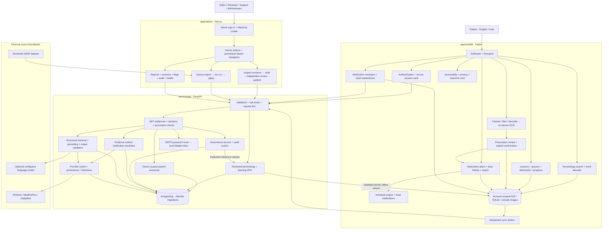

# MediExplain project graph

This graph maps the implementation in this checkout. It separates patient data, reviewed reference content, administrative governance, and external services.

## Ownership and acceptance checks

| Area | Implementation | Verification |
| --- | --- | --- |
| Authentication and sessions | `core/auth`, `core/network`, `features/auth`; API auth service and routers | Register, login, refresh, offline recovery, logout, session revocation, audience separation |
| Terminology and learning | Mobile terminology/learning features; API terminology/learning/module2 routers | Reviewed-only search, ambiguity, saved content, quizzes, spaced repetition, offline data |
| Prescription pipeline | Mobile prescription feature; API prescriptions router | Capture permissions, private files, OCR correction, confirmation state machine, owner-scoped sync |
| Medication management | Mobile medications feature; API medications router | Confirmed plans, schedule boundaries, dose conflicts, reminders, export, privacy |
| Medication intelligence | Mobile intelligence feature; API providers, medication intelligence, medical RAG | Evidence, stable identities, citations, stale cache, safe unavailable states |
| Administration | Next.js routes/actions; API admin auth and governance | Permissions, MFA, editorial transitions, imports, reports, sessions, audit |
| Delivery and operations | Compose, Dockerfiles, CI, `ops`, deployment documents | Fresh migrations, schema check, deterministic builds, readiness, backup/restore |

## Runtime boundaries

- Patient and admin tokens use separate audiences. The API enforces access independently of visible navigation.
- OCR extracts text. The user confirms it before medication plans are created.
- External reference providers supply medical evidence. Optional AI explains retrieved evidence and cannot create medical facts.
- Reference datasets and patient mutations have separate update paths.
- Bundled seeds populate fresh databases only; startup preserves downloaded or published releases. A failed reference update preserves bookmarks and learning progress.
- Authenticated accounts and guests have separate local data and outboxes. A transport bound to one account rejects requests after the account changes.
- Device camera, biometrics, notifications, speech, Android/iOS signing, source licensing, and deployed infrastructure require checks in their actual runtime environments.

See [release verification](RELEASE_VERIFICATION.md) for measured results and remaining release requirements.
